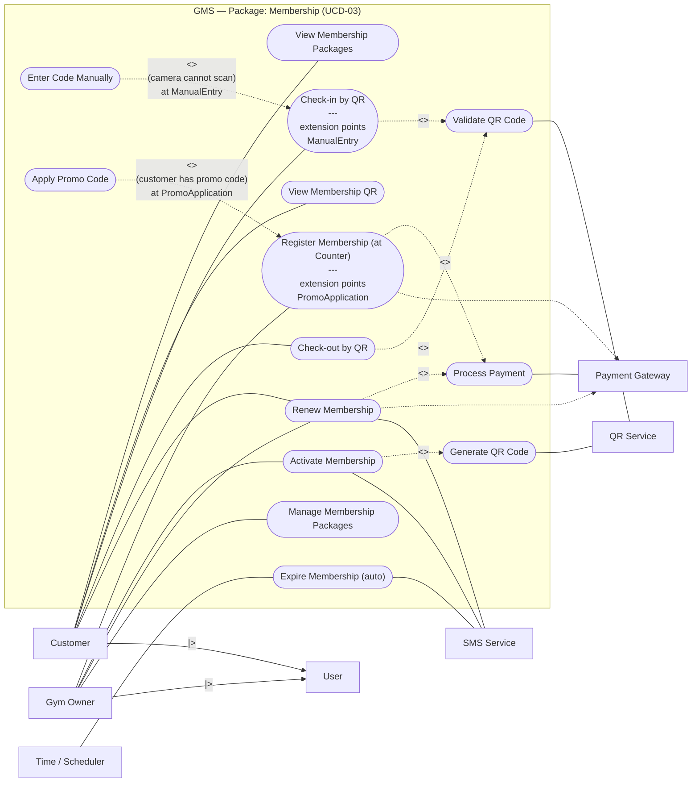

# Bước 3 — Thiên (UCD Membership)

## 1. UC trong package Membership (`UCD-03 Membership`)

### 1.1. Danh sách Use Case nghiệp vụ chính (9 UC)

| UC-ID (trong SRS) | Tên trên oval Visual Paradigm (English Verb + Noun) | Primary Actor (Trái) | Secondary Actor (Phải) | Extension Points (trên oval) | BR liên quan |
|-------------------|-----------------------------------------------------|----------------------|------------------------|------------------------------|--------------|
| **UC-04** | `View Membership Packages` | Customer | — | — | — |
| **UC-05** | `Register Membership (at Counter)` | Gym Owner | Payment Gateway *(dashed/via include)* | `PromoApplication` | BR-01, BR-02 |
| **UC-06** | `Activate Membership` | Gym Owner | SMS Service, QR Service *(via include)* | — | BR-01..BR-04 |
| **UC-07** | `View Membership QR` | Customer | — | — | BR-04 |
| **UC-08** | `Check-in by QR` | Customer | QR Service *(via include)* | `ManualEntry` | BR-04, BR-05 |
| **UC-09** | `Check-out by QR` | Customer | QR Service *(via include)* | — | BR-04, BR-05 |
| **UC-20** | `Renew Membership` | Customer, Gym Owner | Payment Gateway *(via include)*, SMS Service | — | BR-02..BR-04 |
| **UC-23** | `Manage Membership Packages` | Gym Owner | — | — | — |
| **UC-27** | `Expire Membership (auto)` | Time / Scheduler | SMS Service | — | BR-04, BR-11 |

### 1.2. Các Use Case phụ trợ (`<<include>>` / `<<extend>>`) dùng trong package Membership

| Tên trên oval Visual Paradigm | Loại UC | Tương tác với Secondary Actor | Vai trò trong sơ đồ `UCD-03 Membership` |
|-------------------------------|---------|-------------------------------|-----------------------------------------|
| `Process Payment` | Included UC | `Payment Gateway` | Được `<<include>>` bởi `Register Membership (at Counter)` và `Renew Membership` |
| `Generate QR Code` | Included UC | `QR Service` | Được `<<include>>` bởi `Activate Membership` |
| `Validate QR Code` | Included UC | `QR Service` | Được `<<include>>` bởi `Check-in by QR` và `Check-out by QR` |
| `Enter Code Manually` | Extending UC | — | `<<extend>>` vào `Check-in by QR` tại điểm mở rộng `ManualEntry` |
| `Apply Promo Code` | Extending UC | — | `<<extend>>` vào `Register Membership (at Counter)` tại điểm mở rộng `PromoApplication` |

---

## 2. Include / Extend / Generalization đã dùng

> **Chiều mũi tên chuẩn trên Visual Paradigm (khớp với `UCD_Overview.png`):**
> - **`<<include>>`**: Mũi tên nét đứt đi từ **Base UC → Included UC**.
> - **`<<extend>>`**: Mũi tên nét đứt đi từ **Extending UC → Base UC**, kèm điều kiện guard và tên `Extension Point`.

| Quan hệ | Từ (Gốc mũi tên) | Tới (Đầu mũi tên) | Extension Point & Condition | Lý do nghiệp vụ |
|---------|------------------|-------------------|-----------------------------|-----------------|
| `<<include>>` | `Register Membership (at Counter)` (`UC-05`) | `Process Payment` | — *(luôn thực thi khi thu phí)* | Ghi nhận/xử lý khoản thanh toán trước khi kích hoạt thẻ (`BR-02`). |
| `<<include>>` | `Renew Membership` (`UC-20`) | `Process Payment` | — *(luôn thực thi khi gia hạn)* | Gia hạn gói tập bắt buộc phải hoàn tất thanh toán phí gia hạn (`BR-02`). |
| `<<include>>` | `Activate Membership` (`UC-06`) | `Generate QR Code` | — *(luôn thực thi khi kích hoạt)* | Mỗi thẻ `ACTIVE` bắt buộc sinh đúng 1 mã QR định danh duy nhất (`BR-04`). |
| `<<include>>` | `Check-in by QR` (`UC-08`) | `Validate QR Code` | — *(luôn thực thi mỗi lượt vào)* | Bắt buộc giải mã và kiểm tra hiệu lực mã QR với `QR Service` (`BR-04`, `BR-05`). |
| `<<include>>` | `Check-out by QR` (`UC-09`) | `Validate QR Code` | — *(luôn thực thi mỗi lượt ra)* | Bắt buộc xác thực mã QR hợp lệ trước khi ghi nhận giờ ra (`CheckOutTime`). |
| `<<extend>>` | `Enter Code Manually` | `Check-in by QR` (`UC-08`) | **EP:** `ManualEntry` **Condition:** `(camera cannot scan)` | Cho phép nhập mã thẻ thủ công khi camera quét lỗi hoặc màn hình điện thoại khách bị hỏng (`DE-03`). |
| `<<extend>>` | `Apply Promo Code` | `Register Membership (at Counter)` (`UC-05`) | **EP:** `PromoApplication` **Condition:** `(customer has promo code)` | Áp mã giảm giá tùy chọn khi khách hàng có voucher khuyến mãi hợp lệ. |
| **Actor Gen.** | `Customer`, `Gym Owner` | `User` *(Abstract Actor)* | Kế thừa tổng quát hóa (`<|--`) | Đồng bộ hệ thống phân cấp Actor với sơ đồ `UCD-01 Overview`. |

---

## 3. Sơ đồ xem trước `UCD-03 Membership` (Khớp 100% với `UCD_Overview.png` & `UCD-01_Overview.puml`)

---

## 5. PNG đã export

- [x] `03_Images/UCD_Membership.png` *(draft from `02_Models/UCD-03_Membership.puml` — redraw in `GMS.vpp` for official VP export)*

---

## 6. Ghi chú

- Toàn bộ tên Use Case, tên Actor, tên Extension Points (`ManualEntry`, `PromoApplication`) và chiều mũi tên trong file này đã được đối chiếu khớp tuyệt đối với `02_Models/UCD-01_Overview.puml` và `03_Images/UCD_Overview.png` mà Phước đã tạo trên nhánh `step-3`.
- Khi tái sử dụng (drag & drop từ Model Explorer) trong `GMS.vpp`, mọi thay đổi thuộc tính của UC sẽ tự động đồng bộ giữa `UCD-01 Overview` và `UCD-03 Membership`.
