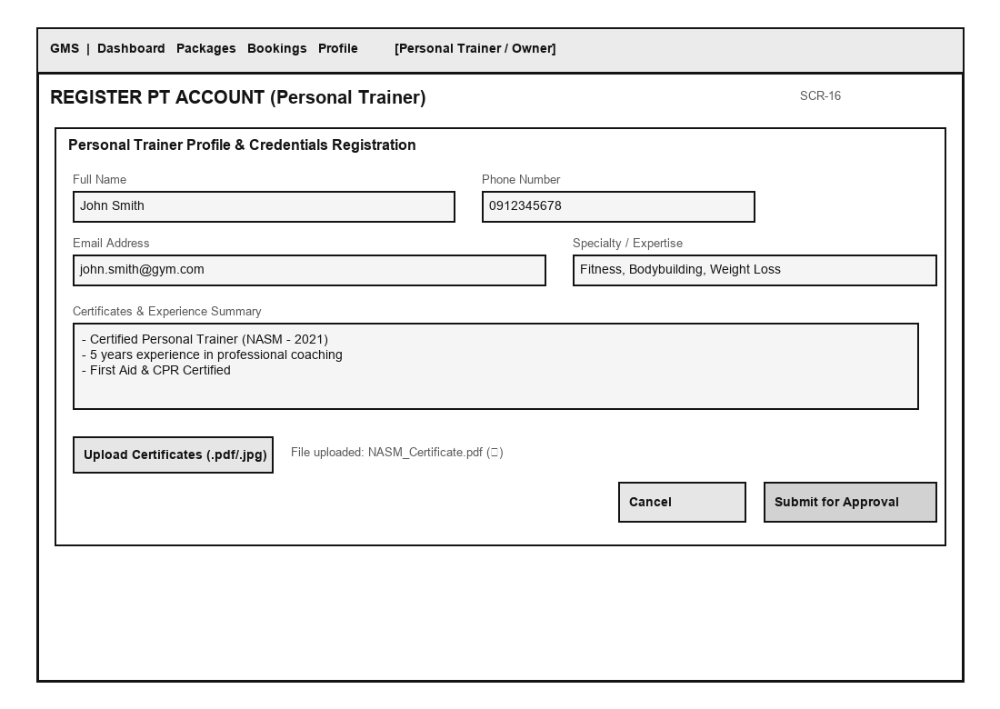
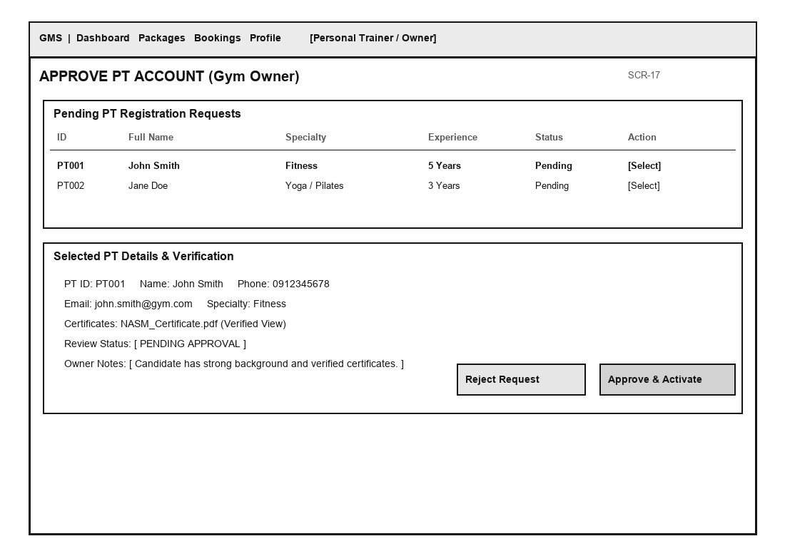

# Bước 5 — Huy (UI UC-16, UC-17)

> Issue: #28 · Nhánh: `step5/huy-ui`

## Màn hình & PNG

| UC | Tên màn hình | File PNG |
|----|--------------|----------|
| UC-16 | Form Đăng ký tài khoản Personal Trainer | `03_Images/UI_UC-16_RegisterPT.png` |
| UC-17 | Màn hình Duyệt tài khoản PT (Gym Owner) | `03_Images/UI_UC-17_ApprovePT.png` |

---

## 1. Màn hình UC-16: Form Đăng ký PT



---

## 2. Màn hình UC-17: Duyệt tài khoản PT (Gym Owner)



---

## Bảng field (tóm tắt)

| Màn hình | Field | Bắt buộc | Validation / lỗi |
|----------|-------|----------|------------------|
| UC-16 (Register PT) | Họ và tên | Có | Không rỗng, 2 - 50 ký tự |
| UC-16 (Register PT) | Số điện thoại | Có | Đúng 10 chữ số, định dạng VN (03x, 05x, 07x, 08x, 09x), chưa tồn tại trên hệ thống |
| UC-16 (Register PT) | Email | Có | Đúng định dạng email standard, chưa tồn tại trên hệ thống |
| UC-16 (Register PT) | Mật khẩu | Có | Tối thiểu 8 ký tự, gồm ít nhất 1 chữ hoa, 1 chữ thường, 1 số và 1 ký tự đặc biệt |
| UC-16 (Register PT) | Nhập lại mật khẩu | Có | Khớp 100% với ô Mật khẩu |
| UC-16 (Register PT) | Chuyên môn (Specialty) | Có | Đã chọn ít nhất 1 chuyên môn (Gym, Yoga, Boxing, Crossfit...) |
| UC-16 (Register PT) | Số năm kinh nghiệm | Có | Số nguyên dương từ 0 đến 40 |
| UC-16 (Register PT) | File Chứng chỉ / Bằng cấp | Có | Định dạng PDF/JPG/PNG, dung lượng < 5MB/file |
| UC-17 (Approve PT) | Bộ lọc trạng thái | Không | Chọn một trong các giá trị: Tất cả, Chờ duyệt (Pending), Đã duyệt, Từ chối |
| UC-17 (Approve PT) | Lý do từ chối | Có (khi Reject) | Bắt buộc nhập nếu bấm Từ chối, độ dài 10 - 200 ký tự |

---

## Text Wireframe Layout Reference

### 1. Wireframe UC-16: Form Đăng ký PT (`UI_UC-16_RegisterPT.png`)

```text
+-----------------------------------------------------------------------+
| GYM MANAGEMENT SYSTEM (GMS) - ĐĂNG KÝ TÀI KHOẢN PERSONAL TRAINER      |
+-----------------------------------------------------------------------+
|                                                                       |
|  [!] Điền đầy đủ thông tin bên dưới để gửi hồ sơ duyệt tài khoản PT.  |
|                                                                       |
|  Họ và tên (*):      [ Nguyen Van A                         ]         |
|  Số điện thoại (*):  [ 0912345678                           ]         |
|  Email (*):          [ pt.nguyenvana@gmail.com             ]         |
|  Mật khẩu (*):       [ ••••••••••••                         ]         |
|  Nhập lại MK (*):    [ ••••••••••••                         ]         |
|                                                                       |
|  Chuyên môn (*):     [x] Gym/Fitness  [ ] Yoga  [x] Kickboxing        |
|  Kinh nghiệm (*):    [ 3 ] năm                                        |
|                                                                       |
|  Tải lên chứng chỉ(*):                                                |
|  +-----------------------------------------------------------------+  |
|  | [Choose File] Certificate_NASM.pdf (1.2 MB)                     |  |
|  +-----------------------------------------------------------------+  |
|                                                                       |
|  Mô tả bản thân:                                                      |
|  +-----------------------------------------------------------------+  |
|  | Chuyên huấn luyện giảm mỡ, tăng cơ và phục hồi chức năng...    |  |
|  +-----------------------------------------------------------------+  |
|                                                                       |
|         [ HỦY BỎ ]                       [ GỬI HỒ SƠ ĐĂNG KÝ ]        |
+-----------------------------------------------------------------------+
```

### 2. Wireframe UC-17: Duyệt tài khoản PT (`UI_UC-17_ApprovePT.png`)

```text
+-----------------------------------------------------------------------+
| GYM MANAGEMENT SYSTEM - QUẢN LÝ & DUYỆT HỒ SƠ PT (GYM OWNER)          |
+-----------------------------------------------------------------------+
| Dashboard | Hội viên | Đặt lịch PT | [Duyệt PT (3)] | Báo cáo | Logout|
+-----------------------------------------------------------------------+
|                                                                       |
| Danh sách hồ sơ PT chờ duyệt:                                         |
| Tìm kiếm: [ nhập tên/SĐT... ]   Trạng thái: [ Chờ duyệt (Pending) v ]   |
|                                                                       |
| +-------------------------------------------------------------------+ |
| | Mã PT: PT004 | Nguyễn Văn A | SĐT: 0912345678                     | |
| | Chuyên môn: Gym/Fitness, Kickboxing | Kinh nghiệm: 3 năm          | |
| | File chứng chỉ: [Certificate_NASM.pdf (Tải về)]                   | |
| | Ngày đăng ký: 10/11/2026 14:30                                    | |
| |                                                                   | |
| | [ XEM CHI TIẾT HỒ SƠ ]      [ TỪ CHỐI ]      [ CHẤP NHẬN DUYỆT ]  | |
| +-------------------------------------------------------------------+ |
|                                                                       |
| Modal khi chọn Từ chối:                                               |
| +-------------------------------------------------------------------+ |
| | XÁC NHẬN TỪ CHỐI HỒ SƠ PT004                                      | |
| | Nhập lý do từ chối (*):                                           | |
| | +---------------------------------------------------------------+ | |
| | | Chứng chỉ chưa đúng chuẩn quy định của phòng tập...           | | |
| | +---------------------------------------------------------------+ | |
| |              [ HỦY ]             [ XÁC NHẬN TỪ CHỐI ]             | |
| +-------------------------------------------------------------------+ |
+-----------------------------------------------------------------------+
```