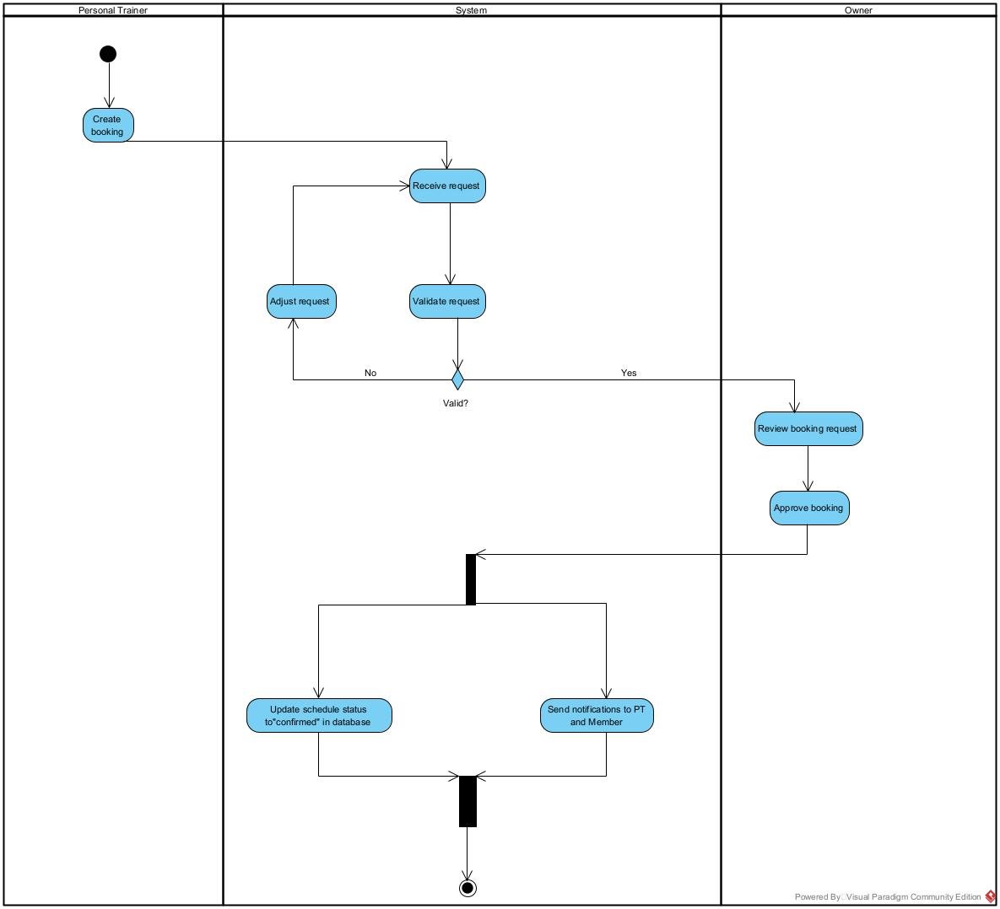

# Step 6 — Huy — AD-02

> Issue: #31 · Branch: `step6/huy-ad02`

## Swimlanes (≥3)

- **Personal Trainer (PT):** Creates booking requests and adjusts schedule details upon validation failure.
- **System (GMS):** Validates request constraints, handles routing, updates the database, and sends automated notifications.
- **Owner / Manager:** Reviews and approves valid PT booking requests.

## Decision / Parallel Branching

- **Decision Node (Valid?):** Checks time slot availability and schedule constraints.
  - **No:** Routes to `Adjust request` and loops back to `Receive request` for re-validation.
  - **Yes:** Forwards the booking request to the `Owner / Manager` lane for manual review and approval.
- **Parallel Branching (Fork / Join):** Executes two concurrent tasks upon approval:
  1. Updates the schedule status to "confirmed" in the database.
  2. Sends completion notifications to both the PT and Member.

## PNG

- [x] `03_Images/AD_ApprovePT.png`