# Bước 7 — Thiên (State Machine Diagrams: SMD-01 & SMD-02)

> **Issue:** [#34](https://github.com/phuocvanday/SWR302-GroupOfFour/issues/34) · **Branch:** `step-7`  
> **Chuẩn Rubric (Hướng dẫn C.2 & D.6):**
> - Số lượng: **≥ 2 State Machine Diagrams** (`SMD-01 Membership Lifecycle`, `SMD-02 PT Booking Lifecycle`).
> - Mỗi sơ đồ có **≥ 5 trạng thái (states)** thực tế (tính từ/phân từ, không nhầm với hành động).
> - Mọi mũi tên chuyển trạng thái (transition) đều ghi đầy đủ cú pháp chuẩn UML: **`event [guard] / action`** và ánh xạ tới đúng `UC-xx` / `BR-xx`.
> - Không có trạng thái "chết" (mọi trạng thái đều đến được từ `Initial` và có đường đi tới `Final`).

---

## 1. SMD-01: Membership Lifecycle (`03_Images/SMD_Membership.png`)

### 1.1. Danh sách trạng thái (5 States + Initial/Final)

| # | State Name (trên VP) | Ý nghĩa nghiệp vụ | Entry / Do / Exit Action | Hiệu lực mã QR (`BR-04`) |
|---|----------------------|-------------------|--------------------------|--------------------------|
| — | `[*] Initial` | Điểm bắt đầu trước khi hồ sơ thẻ hội viên được khởi tạo. | — | Chưa có QR |
| 1 | **`Inactive`** | Thẻ hội viên vừa được tạo tại quầy (`UC-05`), đang chờ thanh toán đủ phí hoặc chờ lệnh kích hoạt. | `entry / create Membership record (QR = null)` | Không hợp lệ |
| 2 | **`Active`** | Thẻ đã thu đủ 100% phí và được Gym Owner kích hoạt (`UC-06`) hoặc gia hạn (`UC-20`); hội viên được phép quét QR check-in/out (`UC-08`, `UC-09`). | `entry / enable QR token; set EndDate` | **Hợp lệ (1 QR duy nhất)** |
| 3 | **`Suspended`** | Thẻ bị Gym Owner tạm khóa do vi phạm nội quy phòng tập hoặc chờ giải quyết tranh chấp. | `entry / disable QR token; log suspension reason` | Bị vô hiệu hóa tạm thời |
| 4 | **`Expired`** | Thẻ đã quá hạn (`current_date > end_date`), bị tác vụ tự động `Time / Scheduler` chuyển trạng thái (`UC-27`); chờ hội viên gia hạn (`UC-20`). | `entry / invalidate QR token; send expiry SMS` | Bị vô hiệu hóa |
| 5 | **`Cancelled`** | Hồ sơ thẻ `Inactive` bị hủy bỏ do khách không hoàn tất thanh toán, hoặc thẻ `Suspended`/`Expired` bị đóng vĩnh viễn. | `entry / revoke QR permanently; archive record` | Đã hủy vĩnh viễn |
| — | `[*] Final` | Kết thúc vòng đời lưu trữ hoạt động của bản ghi Membership. | — | — |

### 1.2. Bảng chuyển trạng thái (State Transition Table — `SMD-01`)

| # | Trạng thái hiện tại (Source) | Sự kiện (Event / Trigger) | Điều kiện (Guard `[...]`) | Hành động (Action `/ ...`) | Trạng thái kế (Target) | UC / BR liên quan |
|---|------------------------------|---------------------------|---------------------------|----------------------------|------------------------|-------------------|
| T1 | `[*] Initial` | `registerMembership` | `[valid customer & package]` | `createMembership(INACTIVE)` | **`Inactive`** | `UC-05`, `BR-01` |
| T2 | **`Inactive`** | `activate` | `[full fee paid]` | `computeEndDate(); generateQR(); sendActivationSMS()` | **`Active`** | `UC-06`, `BR-02`, `BR-03`, `BR-04` |
| T3 | **`Inactive`** | `cancelRegistration` | `[unpaid or owner cancels]` | `markVoid(); releasePendingOrder()` | **`Cancelled`** | `UC-05` (Alt) |
| T4 | **`Active`** | `renew` | `[renewal payment success]` | `extendEndDate(DurationMonths); sendRenewalSMS()` | **`Active`** *(self-transition)* | `UC-20`, `BR-02`, `BR-03` |
| T5 | **`Active`** | `when(current_date > end_date)` | `[status == ACTIVE]` | `invalidateQR(); sendExpirySMS()` | **`Expired`** | `UC-27`, `BR-04`, `BR-11` |
| T6 | **`Active`** | `suspend` | `[rule violation detected]` | `disableQR(); notifyCustomer()` | **`Suspended`** | `BR-04` |
| T7 | **`Suspended`** | `reactivate` | `[issue resolved & end_date >= today]` | `enableQR(); sendReactivationSMS()` | **`Active`** | `BR-01`, `BR-04` |
| T8 | **`Suspended`** | `when(current_date > end_date)` | `[status == SUSPENDED]` | `invalidateQR(); notifyExpiry()` | **`Expired`** | `UC-27`, `BR-11` |
| T9 | **`Suspended`** | `terminate` | `[severe violation]` | `revokeQR(); archiveMembership()` | **`Cancelled`** | `BR-04` |
| T10 | **`Expired`** | `renew` | `[renewal payment success]` | `resetDates(today, DurationMonths); reactivateQR(); sendSMS()` | **`Active`** | `UC-20`, `BR-02`, `BR-03`, `BR-04` |
| T11 | **`Expired`** | `archive` | `[after(365 days expired)]` | `archiveHistoricalData()` | **`Cancelled`** | Data Retention |
| T12 | **`Cancelled`** | `closeRecord` | — | `commitArchive()` | `[*] Final` | — |

### 1.3. Sơ đồ minh họa `SMD-01 Membership Lifecycle`

```mermaid
stateDiagram-v2
    [*] --> Inactive : registerMembership [valid customer & package] / createMembership(INACTIVE)

    Inactive --> Active : activate [full fee paid] / computeEndDate(); generateQR(); sendActivationSMS()
    Inactive --> Cancelled : cancelRegistration [unpaid or owner cancels] / markVoid()

    Active --> Active : renew [renewal payment success] / extendEndDate(); sendRenewalSMS()
    Active --> Expired : when(current_date > end_date) [status == ACTIVE] / invalidateQR(); sendExpirySMS()
    Active --> Suspended : suspend [rule violation detected] / disableQR(); notifyCustomer()

    Suspended --> Active : reactivate [issue resolved & end_date >= today] / enableQR(); sendReactivationSMS()
    Suspended --> Expired : when(current_date > end_date) / invalidateQR()
    Suspended --> Cancelled : terminate [severe violation] / revokeQR(); archiveMembership()

    Expired --> Active : renew [renewal payment success] / resetDates(); reactivateQR(); sendSMS()
    Expired --> Cancelled : archive [after(365 days expired)] / archiveHistoricalData()

    Cancelled --> [*] : closeRecord / commitArchive()
```

---

## 2. SMD-02: PT Booking Lifecycle (`03_Images/SMD_PTBooking.png`)

### 2.1. Danh sách trạng thái (6 States + Initial/Final)

| # | State Name (trên VP) | Ý nghĩa nghiệp vụ | Entry / Do / Exit Action | Ghi nhận buổi tập (`BR-10`) |
|---|----------------------|-------------------|--------------------------|-----------------------------|
| — | `[*] Initial` | Điểm bắt đầu trước khi Customer đặt gói tập PT. | — | Không được phép |
| 1 | **`Pending`** | Customer đã chọn gói PT và thanh toán thành công (`UC-11`); đang chờ PT phản hồi xác nhận hoặc từ chối trong vòng 24 giờ (`BR-08`). | `entry / start 24h response timer; notifyPT()` | Không được phép |
| 2 | **`Confirmed`** | PT đã chấp nhận yêu cầu booking trong hạn 24 giờ (`UC-12`); cho phép PT tạo lịch tập (`UC-13`) và bắt đầu ghi nhận buổi tập đầu tiên (`UC-15`). | `entry / stop 24h timer; sendConfirmSMS(); unlockSchedule()` | Được phép (`remaining == total`) |
| 3 | **`In Progress`** | Đã ghi nhận ít nhất 1 buổi tập (`used_sessions >= 1`) và vẫn còn buổi chưa học (`remaining_sessions >= 1`) qua `UC-15`. | `entry / updateBookingProgress()` | Được phép (`remaining >= 1`) |
| 4 | **`Completed`** | Toàn bộ số buổi trong gói PT đã được thực hiện hết (`remaining_sessions == 0`) sau khi PT lưu buổi cuối trong `UC-15`. | `entry / notifyCompletion(); lockSessionRecording()` | Đã hoàn tất (0 buổi còn lại) |
| 5 | **`Rejected`** | PT từ chối yêu cầu booking ở trạng thái `Pending` kèm lý do bắt buộc (`UC-12`), hệ thống tự động khởi tạo hoàn tiền (`BR-09`). | `entry / recordRejectReason(); initiateRefund(); sendRejectSMS()` | Không được phép |
| 6 | **`Cancelled`** | Booking bị hủy tự động do quá 24h PT không phản hồi (`BR-08`), hoặc do Customer chủ động yêu cầu hủy (`UC-24`). | `entry / releasePTSlots(); processRefundPolicy(); sendCancelSMS()` | Không được phép |
| — | `[*] Final` | Kết thúc vòng đời của đơn đặt gói PT (`PTBooking`). | — | — |

### 2.2. Bảng chuyển trạng thái (State Transition Table — `SMD-02`)

| # | Trạng thái hiện tại (Source) | Sự kiện (Event / Trigger) | Điều kiện (Guard `[...]`) | Hành động (Action `/ ...`) | Trạng thái kế (Target) | UC / BR liên quan |
|---|------------------------------|---------------------------|---------------------------|----------------------------|------------------------|-------------------|
| T1 | `[*] Initial` | `bookPTPackage` | `[membership == ACTIVE & payment == SUCCESS]` | `createBooking(PENDING); notifyPT()` | **`Pending`** | `UC-11`, `BR-06`, `BR-08` |
| T2 | **`Pending`** | `confirmBooking` | `[PT is Approved & within 24h]` | `setConfirmed(); sendConfirmSMS()` | **`Confirmed`** | `UC-12`, `BR-07`, `BR-08` |
| T3 | **`Pending`** | `rejectBooking` | `[reason provided]` | `saveReason(); initiateFullRefund(); sendRejectSMS()` | **`Rejected`** | `UC-12`, `BR-07`, `BR-09` |
| T4 | **`Pending`** | `after(24h)` | `[no PT response]` | `autoCancel(); initiateFullRefund(); sendTimeoutSMS()` | **`Cancelled`** | `BR-08` (Time event) |
| T5 | **`Pending`** | `cancelBooking` | `[requested by Customer]` | `initiateFullRefund(); notifyPT()` | **`Cancelled`** | `UC-24` |
| T6 | **`Confirmed`** | `recordSession` | `[used_sessions == 0 & remaining_sessions > 1]` | `deductSession(); saveNotes(); notifyCustomer()` | **`In Progress`** | `UC-15`, `BR-10` |
| T7 | **`Confirmed`** | `recordSession` | `[total_sessions == 1 & remaining_sessions == 1]` | `deductSession(); markAllDone(); notifyCustomer()` | **`Completed`** | `UC-15`, `BR-10` |
| T8 | **`Confirmed`** | `cancelBooking` | `[used_sessions == 0 & within policy]` | `releaseScheduledSlots(); processRefund(); sendCancelSMS()` | **`Cancelled`** | `UC-24`, `BR-09` |
| T9 | **`In Progress`** | `recordSession` | `[remaining_sessions > 1]` | `deductSession(); saveNotes(); notifyCustomer()` | **`In Progress`** *(self-transition)* | `UC-15`, `BR-10` |
| T10 | **`In Progress`** | `recordSession` | `[remaining_sessions == 1]` *(becomes 0 after deduct)* | `deductFinalSession(); saveNotes(); sendCompletionNotice()` | **`Completed`** | `UC-15`, `BR-10` |
| T11 | **`In Progress`** | `cancelBooking` | `[approved by Owner for partial refund]` | `cancelRemainingSessions(); processPartialRefund()` | **`Cancelled`** | `UC-24` |
| T12 | **`Completed`** | `archiveBooking` | — | `closeBookingLifecycle()` | `[*] Final` | — |
| T13 | **`Rejected`** | `refundSettled` | `[gateway refund confirmed]` | `closeBookingLifecycle()` | `[*] Final` | `UC-12`, `BR-09` |
| T14 | **`Cancelled`** | `refundSettled` | `[refund/cancellation finalized]` | `closeBookingLifecycle()` | `[*] Final` | `UC-24`, `BR-08` |

### 2.3. Sơ đồ minh họa `SMD-02 PT Booking Lifecycle`

```mermaid
stateDiagram-v2
    [*] --> Pending : bookPTPackage [membership == ACTIVE & payment == SUCCESS] / createBooking(PENDING); notifyPT()

    Pending --> Confirmed : confirmBooking [PT Approved & within 24h] / setConfirmed(); sendConfirmSMS()
    Pending --> Rejected : rejectBooking [reason provided] / saveReason(); initiateFullRefund(); sendRejectSMS()
    Pending --> Cancelled : after(24h) [no PT response] / autoCancel(); initiateFullRefund(); sendTimeoutSMS()
    Pending --> Cancelled : cancelBooking [Customer request] / initiateFullRefund(); notifyPT()

    Confirmed --> InProgress : recordSession [remaining > 1] / deductSession(); saveNotes(); notifyCustomer()
    Confirmed --> Completed : recordSession [remaining == 1] / deductSession(); notifyCompletion()
    Confirmed --> Cancelled : cancelBooking [used == 0 & within policy] / releaseSlots(); processRefund()

    state "In Progress" as InProgress
    InProgress --> InProgress : recordSession [remaining > 1] / deductSession(); saveNotes()
    InProgress --> Completed : recordSession [remaining == 1] / deductFinalSession(); sendCompletionNotice()
    InProgress --> Cancelled : cancelBooking [approved partial cancel] / cancelRemainingSessions(); processPartialRefund()

    Completed --> [*] : archiveBooking / closeBookingLifecycle()
    Rejected --> [*] : refundSettled [refund confirmed] / closeBookingLifecycle()
    Cancelled --> [*] : refundSettled [cancellation finalized] / closeBookingLifecycle()
```

---

## 3. PNG cần export từ Visual Paradigm

- [ ] `03_Images/SMD_Membership.png` (`SMD-01`)
- [ ] `03_Images/SMD_PTBooking.png` (`SMD-02`)

---

## 4. Ghi chú đồng bộ với ERD & Use Cases (Cho Tuấn & Huy đối chiếu ở Bước 7)

1. **Đồng bộ giá trị cột `Status` trong ERD (Huy — Issue #35):**
   - Thực thể `Membership.Status`: `INACTIVE`, `ACTIVE`, `SUSPENDED`, `EXPIRED`, `CANCELLED`.
   - Thực thể `PTBooking.Status`: `PENDING`, `CONFIRMED`, `IN_PROGRESS`, `COMPLETED`, `REJECTED`, `CANCELLED`.
2. **Đồng bộ với miền PT của Tuấn (Issue #36):**
   - Nhánh `Pending` → `Confirmed` / `Rejected` phản ánh chính xác Alternative Flow trong `UC-12 (Confirm/Reject PT Booking)`.
   - Nhánh Time Event `after(24h)` từ `Pending` → `Cancelled` thực thi đúng `BR-08` và mục tiêu `BO-03`.
   - Nhánh `Confirmed` → `In Progress` → `Completed` khớp 100% với đặc tả `UC-15 (Record Training Session)` của Thiên ở Bước 4.
